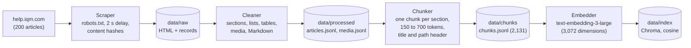
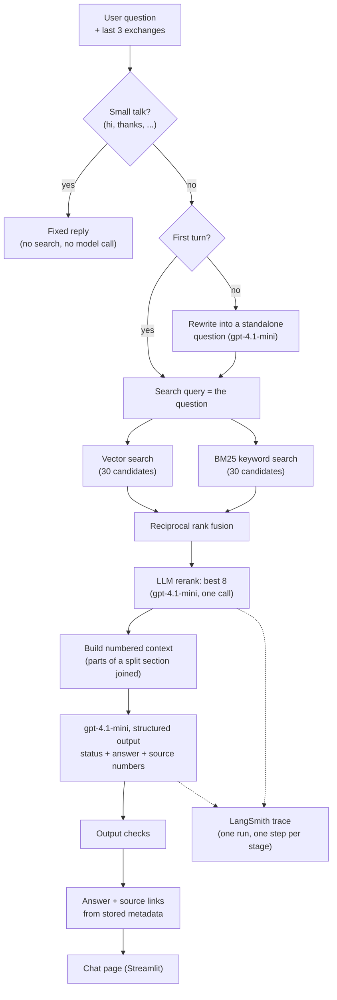

# Architecture

The system has two parts: an offline pipeline that turns the Help Center into a searchable index, and an online path that answers a
question from that index. The same answer chain serves the chat page, the command-line tools and the evaluation runner.

## Offline: from the Help Center to an index

| Step | What it does | Where |
|---|---|---|
| Scrape | Discovers articles through the sitemap and collections, fetches them politely, keeps raw HTML and a hash per article so reruns skip unchanged pages | `src/iqm_rag/scraping/`, `scripts/scrape.py` |
| Clean | Parses each article into sections with paragraphs, lists, tables, FAQ pairs and media; classifies data tables vs layout tables; writes Markdown per section | `scripts/normalize.py` |
| Chunk | Section-based chunks (sections that only list links to other articles are dropped): short sibling sections are merged to at least 150 tokens, long ones split at paragraph, list-item or table-row boundaries (700 token ceiling); tables repeat their header row; each chunk keeps its heading path | `src/iqm_rag/ingestion/chunking.py` |
| Embed and index | Embeds the heading path plus the text, stores the vector with the chunk and its metadata; re-runs only embed new or changed chunks and refuse a model or dimension change without `--rebuild` | `src/iqm_rag/ingestion/` |

Images and videos are not embedded. They are tied to their section (`media_section_ids` on each chunk) so they can be shown later.

## Online: answering a question

1. **Small talk.** A whole-message match for a greeting, thanks, goodbye, "ok" or "what can you do" gets a fixed reply with no search and
   no model call. Anything else continues.
2. **Follow-up handling.** From the second turn a small model rewrites the latest message into a standalone search query using the
   last three exchanges; on any failure the raw question is used. Retrieval never sees history, only the query string.
3. **Retrieval.** The default is hybrid: dense vector search and BM25 keyword search (30 candidates each) merged by reciprocal rank
   fusion, then an LLM reranker picks the best 8 (if it fails, the fused order is kept and a warning is recorded). Each stage is a
   switch (`RETRIEVAL_MODE`, `RERANK`, `NEIGHBOURS`), so `dense` and `off` give the plain baseline; cosine similarity is returned as a
   signal and never used to decide whether to answer. With `NEIGHBOURS=1` the adjacent parts of split sections join the context.
4. **Context.** The chunks become numbered documents with their article title and heading path. URLs are not shown to the model.
5. **Generation.** The model returns a `status` (`answered`, `not_covered` or `clarification`), the answer text and the numbers of
   the fewest documents that support it. The prompt tells it that documents are evidence, not instructions, to answer only from them
   and to say so when they do not cover the question. A reply cut off at the length limit is retried once with a higher limit.
6. **Checks.** Source numbers that were never shown are dropped; an answer with no valid source is shown as "not covered"; sources
   on a not-covered or clarifying reply are ignored. Citation URLs are taken from stored chunk metadata, so the model cannot invent one.
7. **Presentation.** The chat page shows the answer, a status badge, de-duplicated source links and, in Developer mode, the search
   query, the retrieved passages with scores, tokens, timings and the trace ID.

## Cross-cutting parts

- **Tracing.** With a LangSmith key set, every request is one `rag_answer` run with child steps `rewrite`, `retrieve` (a `retrieval_pipeline` run containing `vector_search`, `embed_query`
  and, when switched on, the keyword search and the rerank), `build_context`, `generate` and `check_output`. Without a key nothing is
  sent. See `docs/decisions/FR-08-tracing.md` and `docs/traces/example-trace.json`.
- **Evaluation.** `scripts/evaluate.py` runs a fixed question set through the same chain and scores retrieval, abstention, citations and
  answer quality. See `docs/evaluation-report.md`.
- **Configuration.** All keys and model names come from environment variables (`.env.example`); the models and the number of chunks
  retrieved can be changed without code changes. The index records which embedding model built it and refuses a mismatch.

## Main data records

A chunk (`data/chunks/chunks.jsonl`, and the metadata stored in Chroma): `chunk_id`, `article_id`, `article_title`, `article_url`,
`collection`, `section_path`, `section_ids`, `media_section_ids`, `part` and `parts`, `context_header`, `text`, `token_estimate`,
`last_updated`, `content_hash`.

An answer (`Answer` in `src/iqm_rag/generation/chain.py`): `status`, `text`, `citations`, the rewrite result, the retrieval result,
the documents shown to the model, the unchecked model draft, model and prompt version, token usage, timings and the trace ID.

## Where the decisions are recorded

Each part has a decision record with options considered, evidence and limits in `docs/decisions/` (scraping, cleaning, chunking and
indexing, retrieval, generation, conversation, interface, tracing, evaluation).
